# GhostRunner 1.0.1 · 免安装版

下载：[1.0.1 免安装 EXE 与完整使用包](https://github.com/Xiamo-vip/Fuckrun/releases/tag/v1.0.1)。

Windows 10/11 x64。**双击 `GhostRunner.exe` 即可运行，无需安装本软件，也无需安装 Python。** 单文件首次启动会解压运行依赖，请稍等。

**1.0.1 更新：** 移除全部页面最外层大边框；腾讯地图使用稳定版 JS API、启用 localStorage 并处理样式异常回退；兼容 mitmproxy 12 配置项，修复将 PEM 格式 `.cer` 当成 DER 解析导致的 `ValueError`。本页引导图已按当前 Material 界面重新截取，每张均有 **1–4 编号、箭头和文字说明**。

界面已使用 [material-components-pyside](https://github.com/sudoevolve/material-components-pyside) 的开源 Material Design 3 组件重构，支持系统深浅色、Material You 动态配色、侧边导航、卡片、动效和原生 QtWebEngine 地图。

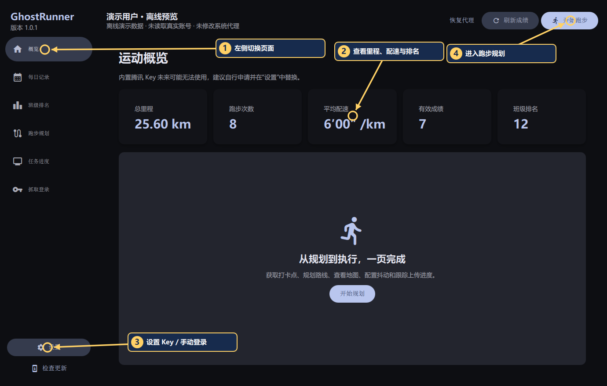

**看图顺序：** ① 左侧切换页面 → ② 查看里程、配速与排名 → ③ 左下角设置 Key / 手动登录 → ④ 右上角进入跑步规划。

## 第一次使用：照着做

### 1. 打开程序并登录
双击 EXE，首次提示中选择 **自动抓取**；也可从左侧 **抓取登录** 进入抓取页。已有自己的 tasktoken 时，选择 **手动填写** 或打开左下角 **设置**。

### 2. 按抓取页提示打开小程序
确认抓取，处理 Windows 证书提示 → 打开 **Windows 微信电脑版** → 打开校园跑步小程序 → 进入成绩 / 跑步记录页。已打开的页面请刷新或重新进入。

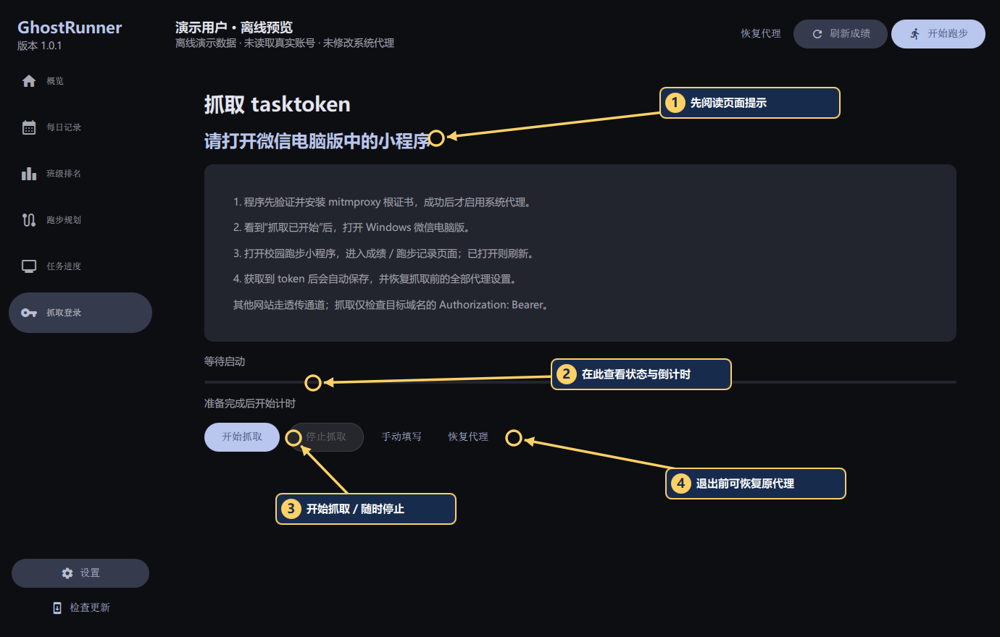

**图中编号：** ① 阅读页面提示 → ② 查看证书、代理状态和倒计时 → ③ 开始抓取 / 随时停止 → ④ 需要时恢复原代理。

页面会明确显示证书准备、代理启用和抓取倒计时。看到“请打开微信小程序”后再进入成绩 / 跑步记录页；成功后 token 自动保存。可随时停止抓取并恢复原代理。

### 3. 检查腾讯 Key
左侧 **设置** 可填写自己的 WebService Key 和 JavaScript GL Key。

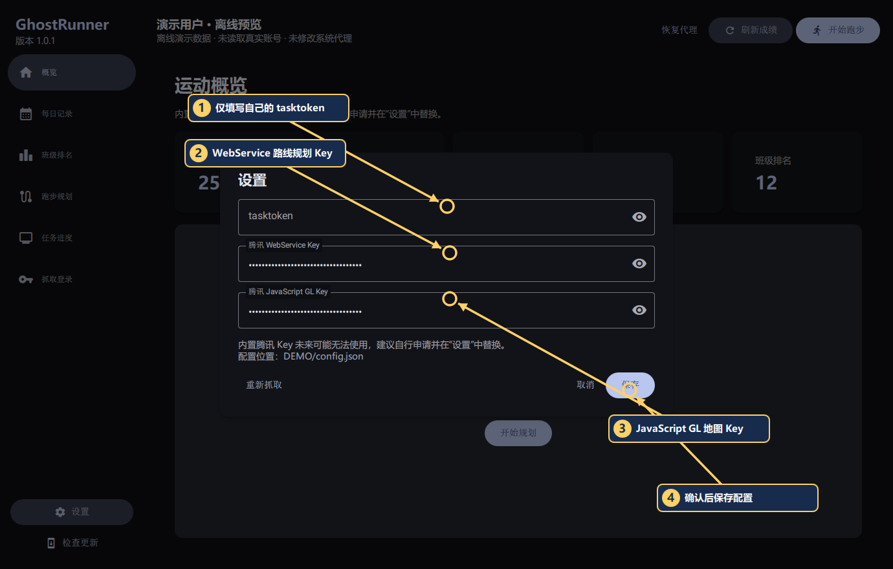

**图中编号：** ① 自己的 tasktoken（已有登录时填写）→ ② WebService Key（路线规划）→ ③ JavaScript GL Key（地图显示）→ ④ 保存。两个 Key 输入框默认隐藏内容。

默认已填入：`JXIBZ-7IQ6I-AJPGJ-UZFYM-NSBRO-YQFPT`。

**这个 Key 未来可能无法使用，建议自行申请一个。** 内置值不代表已验证其权限、额度或持续可用性。已有自定义 Key 不会被覆盖。自行申请请打开[腾讯位置服务控制台](https://lbs.qq.com/dev/console/key/manage)，按控制台说明配置对应产品权限；两个输入框可使用各自的 Key。


<details>
<summary>展开：腾讯 API Key 申请与步行路线额度配置（8 步图文教程）</summary>

以下按提供的控制台截图说明，页面与额度以你登录后的实际显示为准。截图里的应用名、Key 名称可换成便于自己识别的名称。

#### 第 1 步：创建应用
登录[腾讯位置服务控制台](https://lbs.qq.com/dev/console/key/manage)，进入 **应用管理 → 我的应用**，点击右上角 **创建应用**。

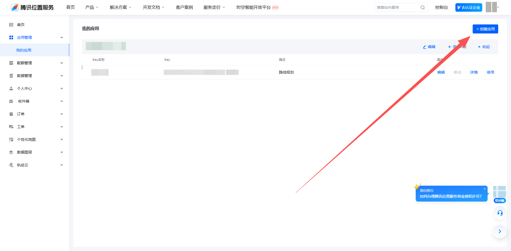

#### 第 2 步：填写应用信息
填写应用名称，按实际用途选择应用类型；图中以“其他”为例，然后点击 **创建**。

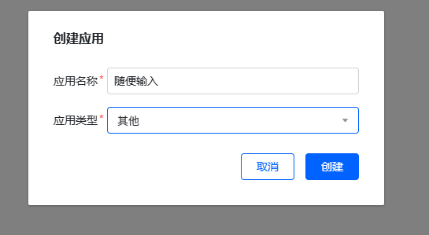

#### 第 3 步：添加 Key
找到刚创建的应用，点击 **添加 Key**。

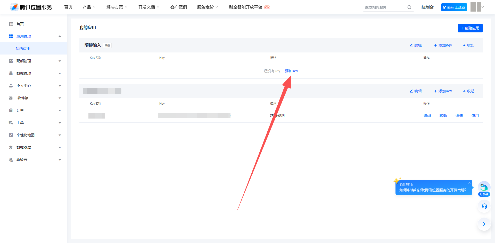

#### 第 4 步：启用 WebServiceAPI
填写 Key 名称与描述，勾选 **WebServiceAPI**，阅读相关协议并按实际情况确认，点击 **添加**。访问限制按自己的应用需求设置，不要为了照图操作而删除已有的安全限制。

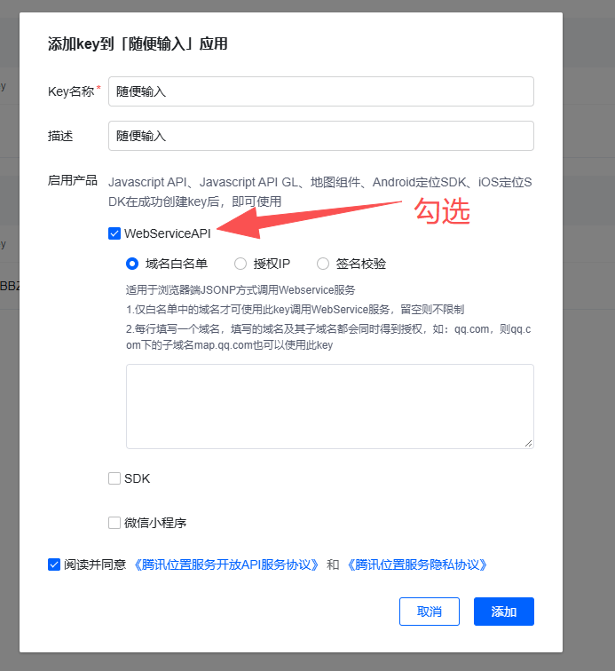

#### 第 5 步：复制到软件
复制新创建的 Key，打开 GhostRunner 左下角 **设置**，粘贴到 **腾讯 WebService Key** 并保存。地图展示使用 **腾讯 JavaScript GL Key**：同一个 Key 支持对应产品时可填相同值，否则分别配置。

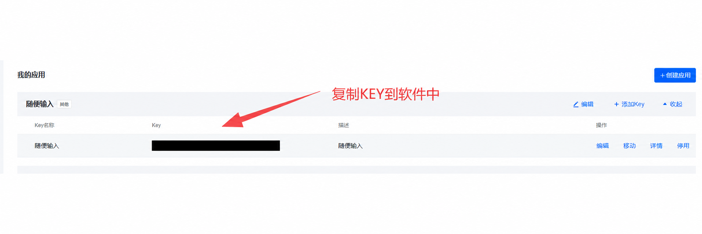

#### 第 6 步：找到步行路线规划额度
进入 **配额管理 → 账户额度**，搜索“路线规划”，找到 **步行路线规划**（`/ws/direction/v1/walking`），点击该行右侧的 **配额分配**。

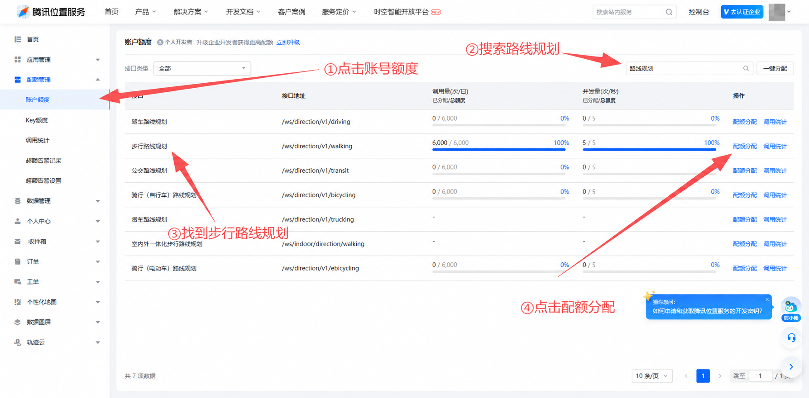

#### 第 7 步：选择新建的 Key
在列表中找到本次新建的 Key，点击其右侧的 **配额分配**。

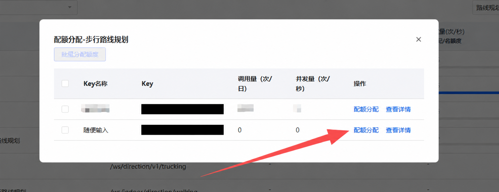

#### 第 8 步：设置额度并提交
确认选中自己的 Key 和步行路线接口，按账户实际可分配额度填写 **调用量（次/日）**、**并发量（次/秒）**，确认没有校验错误后点击 **提交**。

**注意：图中有红色“配额超出最高限额”提示，并非配置成功的示例。不要直接照填 `6000` 和 `5`；请检查剩余额度及其他 Key 的分配情况，调整到控制台允许的范围后再提交。**

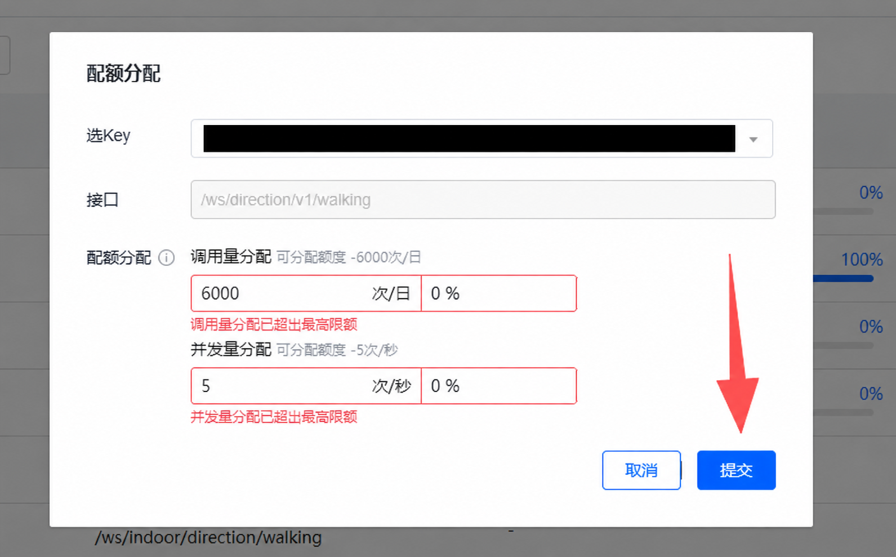

完成后回到软件保存设置，再刷新路线。截图中的可见 Key 和 Key 片段已遮挡；部分图片经过 AI 辅助脱敏处理。请使用自己申请的 Key，不要复制截图内容，并妥善保管凭据。

</details>

### 4. 开始规划
点击右上角 **开始跑步**，等待打卡点和路线显示。地图已改为 QtWebEngine 原生布局，不再把独立 WebView2 窗口嵌入界面；窗口缩放和地图拖动会触发地图画布自适应，避免只显示左上角碎片。

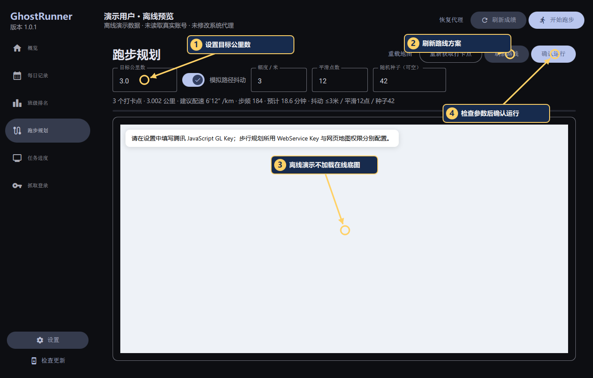

**图中编号：** ① 设置目标公里数 → ② 刷新路线方案 → ③ 查看地图区域（本图是离线演示，不加载在线底图）→ ④ 检查参数后确认运行。

设置目标公里数和抖动参数，点击“刷新路线”切换方案。地图会随窗口和卡片尺寸重排；检查路线、配速和预计时长后点击“确认运行”。

### 5. 查看进度和请求日志

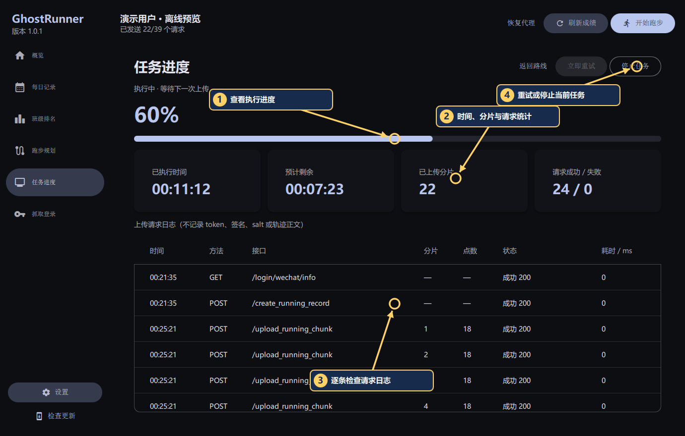

**图中编号：** ① 查看进度条 → ② 查看执行时间、分片与请求统计 → ③ 检查逐条请求日志 → ④ 遇到问题时重试或停止任务。

任务页集中显示进度、已执行时间、预计剩余、上传分片和逐条请求日志。临时网络故障会自动等待重试，也可立即重试或停止任务；创建会话或鉴权失败需手动处理。显示完成不等于平台审核通过，成绩以平台为准。

> 上述 5 张软件截图采集于 2026-10-19，来自当前 1.0.1 无外框 Material 界面。编号、文字标签和箭头在真实 QML 场景中渲染后截图；账号、成绩和请求均为离线演示数据。路线页不加载在线底图，截图不表示已完成真实抓取或真实跑步任务。腾讯控制台 8 步参考图沿用下方说明中的既有脱敏截图，不代表控制台实时状态。

## 记住这几点

- 配置文件：用户目录 `config.json`；token 属于敏感信息，请勿分享。
- 地图使用随程序打包的 QtWebEngine；地图失败时检查网络、JavaScript GL Key 权限和腾讯控制台域名限制。
- “免安装”指本软件。自动抓取会先验证证书有效期及 Windows 信任库，验证成功后才修改系统代理；优先安装到当前用户信任库，必要时再请求管理员权限。结束、取消、超时或退出时恢复原有代理。
- 抓取时小程序联网异常：先停止抓取并点击“恢复代理”。新版不会在证书验证失败时启用代理；仍无法抓取时可手动填写 token。
- 程序启动后会通过 GitHub Releases API 检查新版本；发现新版本时弹窗展示版本说明，并可前往 GitHub Release 页面更新。也可点击左侧“检查更新”。
- 升级：退出旧程序，替换 EXE。免安装版仍会保存本地配置，不等同于零文件写入。

使用前请阅读 [免责声明](DISCLAIMER.md)。源码构建：安装 `requirements.txt` 后执行 `build.ps1`。Material 组件固定自上游提交 `d58599ed510d3939238ecfba61206423fa5c5275`，只包含 LGPL-3.0-or-later 的 `src/Core`，许可见 `third_party/material-components-pyside/LICENSE`。

### 维护引导图

安装依赖后，在项目目录逐项运行：

```powershell
'overview','capture','route','execution','settings' | ForEach-Object { python tests/capture_material_docs.py $_ }
```

脚本只打开离线演示界面，使用独立演示状态目录，不读取真实账号配置、不安装证书、不启用系统代理。
